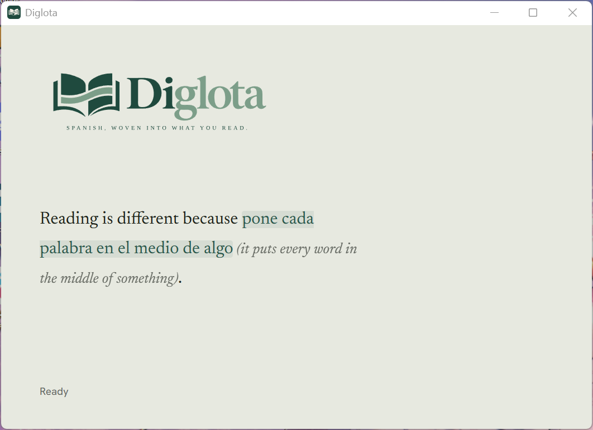
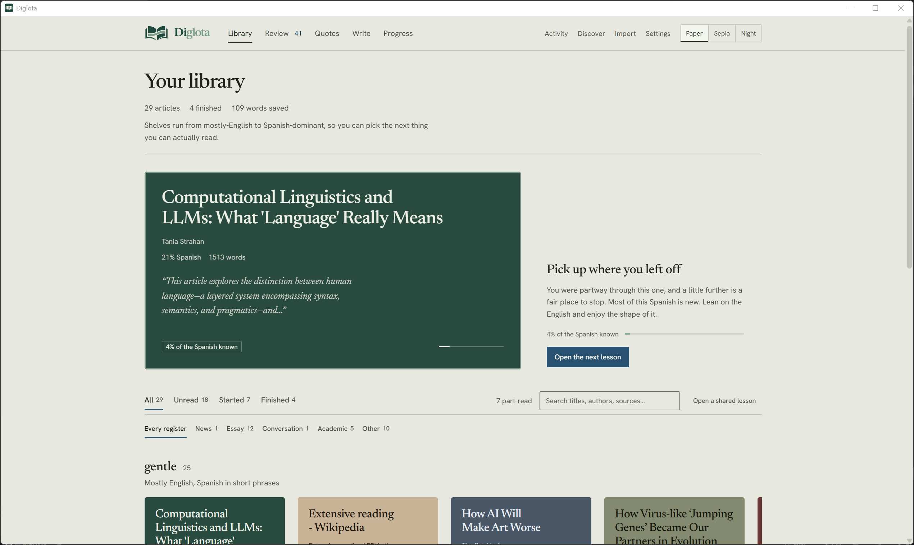
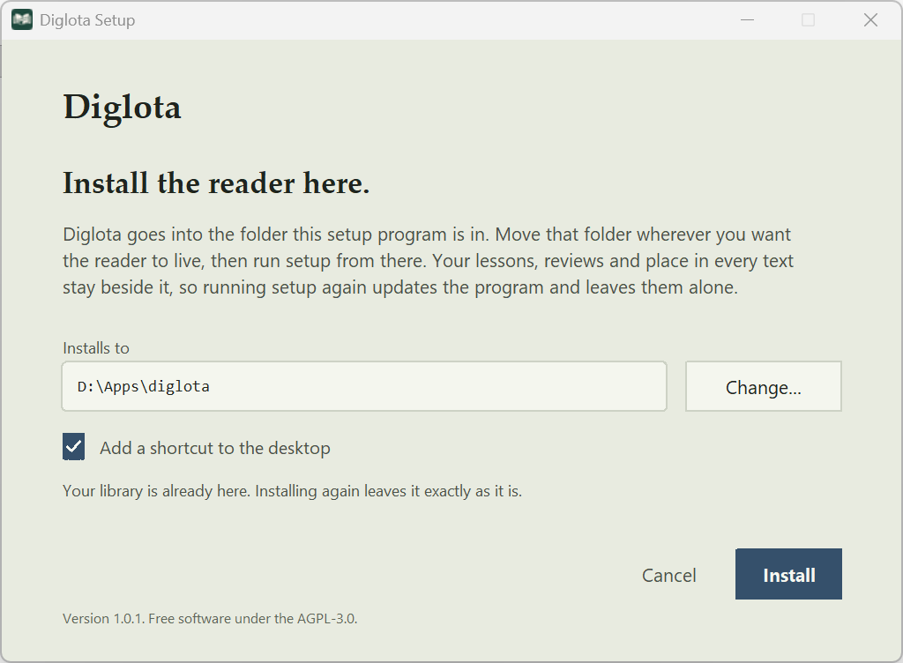
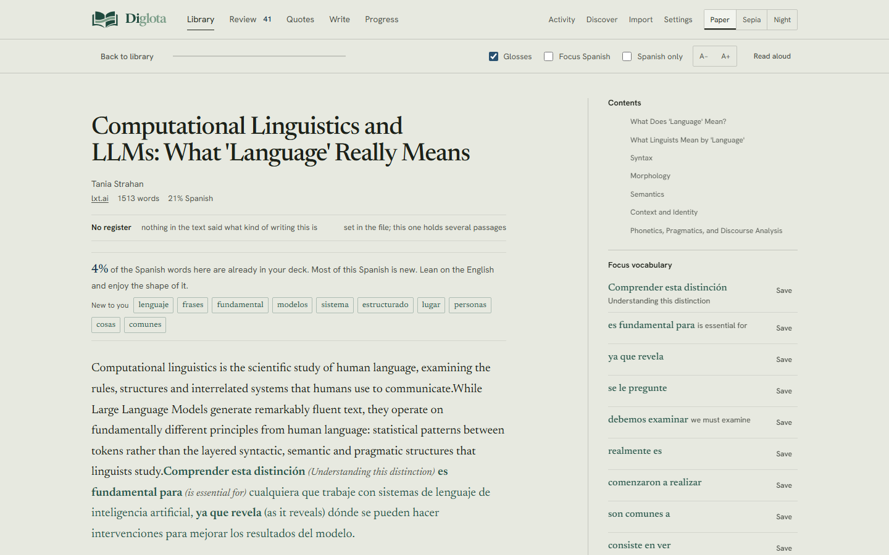
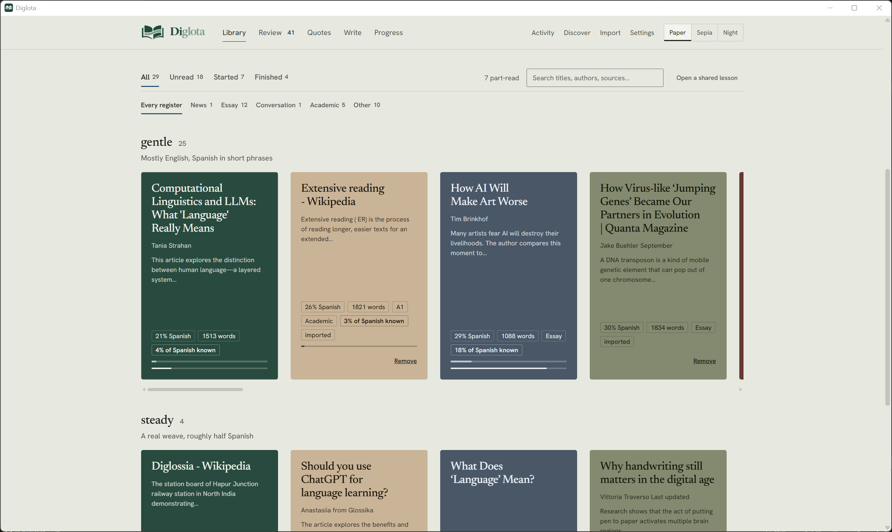
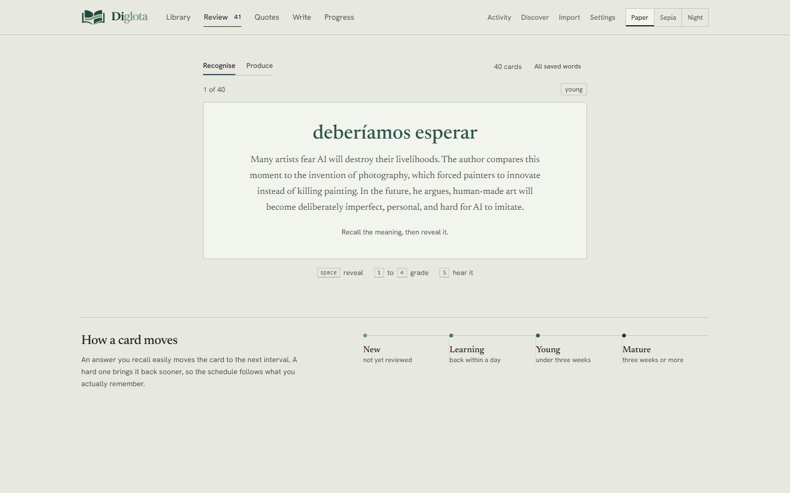
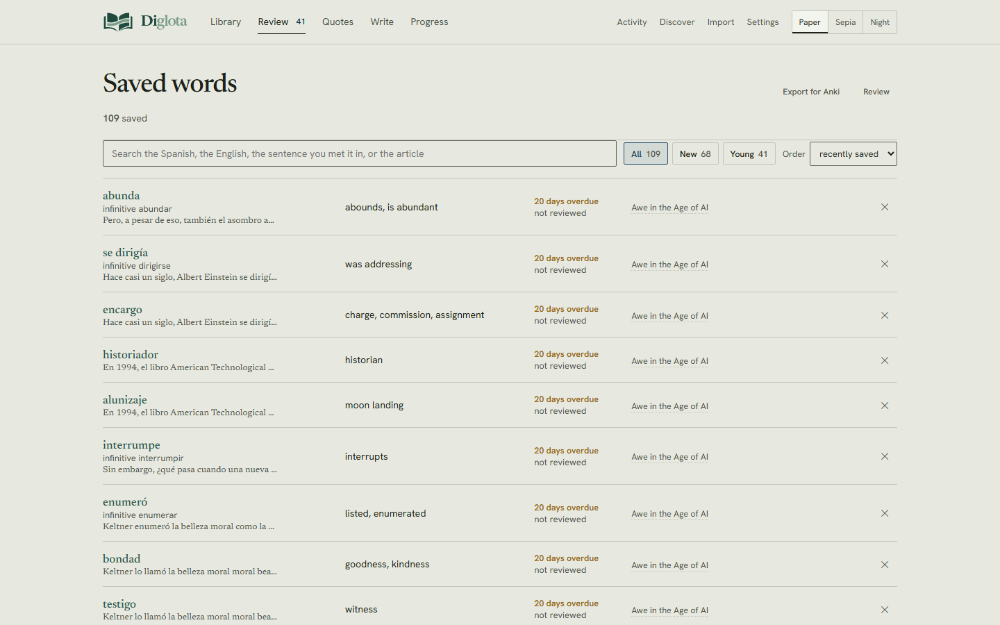
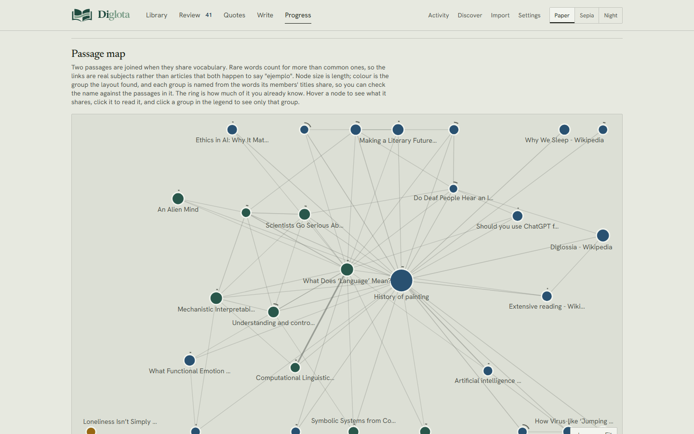
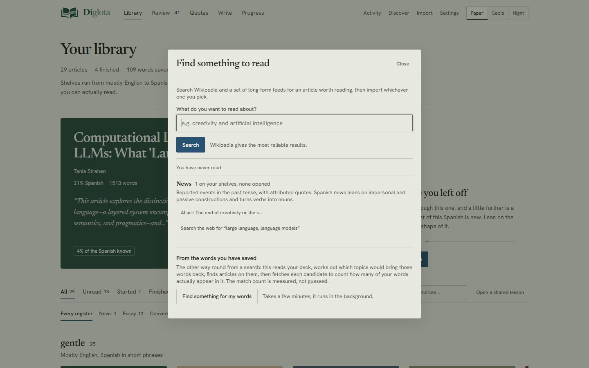

# Diglota

<p align="center">

  <a href="https://github.com/duzui300/diglota"></a>
  <a href="https://github.com/duzui300/diglota"></a>
  <a href="https://github.com/duzui300/diglota"></a>
  <a href="https://github.com/duzui300/diglota"></a>
  <a href="https://github.com/duzui300/diglota"></a>
  <a href="https://hub.xerj.org/contributors/duzui300"></a>

</p>

Diglota is a local-first, reading-focused language learning app built around the **diglot weave** — setting target-language phrases (with short inline glosses) into base-language prose so you can read real articles at any level. It ships with English → Spanish (`en-es`) as the default pair, includes English → French (`en-fr`), and provides a pluggable language-pair architecture ready for additional same-script and cross-script pairs.

The reading surface, morphological dictionary lookups, vocabulary coverage metrics, sentence capture (Quotes), writing metrics, and SM-2 spaced repetition all run **100% offline** with no account and no API key. When you want deeper tutoring, exercise generation, or automatic lesson weaving from any web URL or draft, connect any OpenAI-compatible chat model — and optionally TypeSafe Jev for calibrated semantic grading.





---

## Documentation

- [**Architecture & Invariants (`docs/ARCHITECTURE.md`)**](docs/ARCHITECTURE.md) — Monorepo layout, modular backend/storage/frontend design, SQLite schema, and engineering invariants.
- [**Adding New Language Pairs (`docs/LANGUAGE_PAIRS.md`)**](docs/LANGUAGE_PAIRS.md) — Developer guide for adding same-script (`SameScriptHMMSegmenter`) and cross-script (`CrossScriptSegmenter`) pairs such as `en-zh`, `zh-en`, `en-de`, or `en-ja`.
- [**HTTP & SSE API Reference (`docs/API.md`)**](docs/API.md) — Complete endpoint reference grouped by domain with offline / LLM / Jev requirements.
- [**Development, Testing & Packaging (`docs/DEVELOPMENT.md`)**](docs/DEVELOPMENT.md) — Environment setup, pytest & Playwright suites, corpus QA tools, and Windows installer build instructions.

---

## Three Ways to Run

Diglota provides a native Windows desktop app (installer or portable folder) plus a cross-platform web server.

### 1. One-File Windows Installer (Recommended on Windows)

Works on Windows 10 and 11 (requires Edge WebView2 runtime, preinstalled on Windows 11).

1. Download or build `Diglota-Setup-1.1.0.exe` (`python packages/win/build.py --installer`).
2. Place the setup exe in the folder where Diglota should live (for example, `D:\Apps\Diglota`).
3. Run it. Setup installs **beside itself** with no administrator rights and no hidden copy in `%LOCALAPPDATA%`, creating a Start menu shortcut, an optional desktop shortcut, and a Windows *Settings → Apps* entry.



> **Updating & uninstalling.** Re-running the installer upgrades program files while preserving your database (`data/`) and lessons (`corpus/`). The uninstaller keeps your library, settings, and deck by default unless you explicitly opt to delete them. Silent CLI flags (`--silent`, `--dir`, `--keep-library`, etc.) are documented in [`docs/DEVELOPMENT.md`](docs/DEVELOPMENT.md).

### 2. Portable Desktop Folder (Windows, from Source or Build)

```bash
# Install BOTH engine and Windows desktop dependencies
pip install -r requirements.txt -r packages/win/requirements.txt

# Run the native desktop window from source
cd packages/win
python -m diglota_win

# Build portable folder -> packages/win/dist/Diglota/Diglota.exe
python packages/win/build.py

# Or build portable folder + one-file setup exe -> packages/win/dist/Diglota-Setup-1.1.0.exe
python packages/win/build.py --installer
```

### 3. Web / CLI (Cross-Platform)

```bash
# Install core dependencies
pip install -r requirements.txt

# Start the server (http://127.0.0.1:8787)
python run.py

# Optional flags
python run.py --port 9000 --reload
pythonw run.py --log data/app.log
```

> **Windows browser launcher (`Open Diglota.vbs`).** Double-click `Open Diglota.vbs` to start the server windowlessly via `pythonw` (logging to `data/app.log`) and open Diglota in your default browser. Stop the server anytime via **Settings → Quit the app**.

---

## Configuration & Local-First Storage

- **`data/`** (gitignored): SQLite database (`diglot.db`), Settings panel overrides (`settings.json`), app-imported lessons (`library/`), automatic reset backups (`backups/`), and logs.
- **`corpus/`**: Hand-crafted Markdown lessons (one sample lesson ships in git: `corpus/why-reading-teaches-a-language.md`; add your own `.md` lessons locally).

Optional AI services can be configured in the in-app **Settings** panel (`data/settings.json`, which takes precedence) or via `.env` (see [`.env.example`](.env.example)):

```env
# Optional: semantic evaluation & placement (TypeSafe System One / Jev)
TYPESAFE_API_KEY=your_key_here
TYPESAFE_MODEL=jev-latest

# Optional: interactive tutor, quizzes, glossing, and lesson weaving
LLM_BASE_URL=https://api.openai.com/v1     # Any OpenAI-compatible endpoint
LLM_API_KEY=your_key_here                  # Optional for localhost / LAN endpoints
LLM_MODEL=deepseek-chat                    # Or gpt-4o, etc.

# Optional: separate models for word lookup (e.g. local Ollama) and passage weaving
LOOKUP_LLM_BASE_URL=http://localhost:11434/v1
LOOKUP_LLM_MODEL=qwen3:4b
WEAVE_LLM_BASE_URL=https://api.openai.com/v1
WEAVE_LLM_API_KEY=your_key_here
WEAVE_LLM_MODEL=gpt-4.1

# Optional overrides
DIGLOT_CORPUS=./corpus                     # Curated lesson directory
DIGLOT_DATA=./data                         # Database, settings & imported library directory
DIGLOT_PROXY=                              # HTTP/HTTPS proxy (leave empty to connect directly)
DIGLOT_PAIR=en-es                          # Active language pair (en-es or en-fr)
DIGLOT_WARM_GLOSSES=off                    # Background pre-warming: off, auto, or on
```

> **Key safety.** Keys are never sent to the browser (`repr=False` on `Settings`; the UI receives only `key_set` and a masked `key_hint`).

### Feature Availability Matrix

| Feature | Offline (No Keys) | With Chat LLM (`LLM_*`) | With Chat LLM + TypeSafe Jev |
| :--- | :---: | :---: | :---: |
| **Diglot Reader, Themes & Custom Page Colour** | ✅ Full | ✅ Full | ✅ Full |
| **Instant Local Glossary & Morphological Lookups** | ✅ Full | ✅ Full | ✅ Full |
| **Bilingual TTS Read-Aloud** | ✅ Web Speech API | ✅ Web Speech API | ✅ Web Speech API |
| **SM-2 Spaced Repetition (Vocabulary Deck + Produce Cloze)** | ✅ Full | ✅ Full | ✅ Full |
| **Sentence Capture (Quotes) & Anki CSV Export** | ✅ Full | ✅ Full | ✅ Full |
| **Reading Analytics, Exposure & Corpus Passage Map** | ✅ Full | ✅ Full | ✅ Full |
| **Writing Workspace Live Metrics & Revision History** | ✅ Full | ✅ + AI Feedback & Revisions | ✅ + Calibrated Jev Grading |
| **Deep Dictionary Entries, Grammar Explanations & Translation** | ⚠️ Local glossary only | ✅ Interactive AI tutor | ✅ Interactive AI tutor |
| **Comprehension Quizzes & Translation Drills** | ❌ Requires LLM to generate | ✅ Generated + LLM-graded | ✅ Generated + Calibrated Jev |
| **Web / Paste Import & Lesson Weaver** | ❌ Requires LLM | ✅ Autonomous synthesis | ✅ + Calibrated CEFR/Register |

---

## Core Features

### 1. The Immersive Reader



- **Dual-language typography & themes.** Paper, Sepia, Night, plus custom page colour in Settings. Keyboard shortcuts: `G` (toggle glosses), `F` (fade base language), `E` (target language only), `R` (read aloud), `S` (speak selection), `Esc` (close overlays).
- **Zero-latency morphological lookups.** Author glosses and post-reading vocabulary boxes are compiled into a local glossary shipped to the browser. Unseen words are warmed asynchronously in the background when an article opens.
- **Sentence-synchronized audio.** Read-aloud switches Web Speech API voices at sentence/language boundaries.
- **Register tracking.** Classifies news, essay, conversation, academic, and fiction passages and lets you edit register tags atomically in the lesson file.

### 2. Vocabulary Coverage & Readiness



Every lesson on the shelf displays your known vocabulary coverage (stemming inflected forms, clitics, and stem changes while filtering function words) so you can choose a comfortable next read.

### 3. In-Context Spaced Repetition (SM-2)



- **Cards in context & lemma awareness.** Saved words return inside the exact sentence where you met them, linking inflected forms to their dictionary lemma.
- **Two modes.** Practise **Recognise** (flashcard recall) or **Produce** (cloze typing), with shortcuts `Space` (reveal), `1`–`4` (grade), `S` (speak).
- **Lookup nudges & deck management.** Words looked up **two or more times** without being saved surface as study recommendations. Filter saved words by review stage (`new`, `learning`, `young`, `mature`), sort by recent, alphabetical, due soonest, or most forgotten, search with accent-folding (`cuestion` → `cuestión`), and export directly to Anki CSV (`GET /api/export.csv`).



### 4. Sentence Capture (Quotes)

Select any passage while reading and click **Keep** to save complete sentence boundaries offline. Kept quotes are searchable across text, glosses, and personal notes, and resurface inside word-lookup popovers when you encounter those words again.

### 5. Writing Workspace

Draft in your target language with targeted prompts (drawn from frequent lookups, saved words, quotes, and reading topics), live word count & target-language share, revision history, optional inline **Good / Fix / Style** annotations, side-by-side revisions, and one-click conversion of your own draft into a diglot lesson.

### 6. Reading Analytics, Weekly Goals & Passage Map



Track target-language words read, new vs. familiar vs. repeated vocabulary, scaffolding dependence per 1,000 words, dynamic weekly goals, and an IDF-weighted force-directed passage map showing which articles share vocabulary. You can reset study records anytime from Progress (an automatic consistent SQLite backup is created in `data/backups/` first).

### 7. Semantic Grading, Import, Discovery & Sharing (`diglot/1`)



- **Three-tier grading:** TypeSafe Jev → Chat LLM fallback → asymmetric offline overlap (never falsely condemning a differently worded translation).
- **Lesson ingestion:** Import from any public URL (with SSRF and size safeguards) or pasted text, tuning **Level** (`A1`–`C1` or `Auto`), **Target share** (`15%`–`75%` with presets from Light `22%` to Immersion `68%`), and **Weave mode** (`Mixed` or `Whole sentences`).
- **Discover:** Searches DuckDuckGo, Wikipedia, and 7 curated RSS/Atom feeds, marking articles you already own and highlighting unread registers.
- **Portable sharing (`diglot/1`):** Export and import self-contained `.md` lessons with digest verification and optional `- **Language Pair:** ...` front matter.

---

## Testing

```bash
pip install -r requirements.txt -r requirements-dev.txt
python -m pytest -q
```

See [`docs/DEVELOPMENT.md`](docs/DEVELOPMENT.md) for calibration corpus details, Playwright browser tests (`tools/ui_test.py`), and corpus QA scripts (`tools/segment_qa.py`).

---

## Licence

**GNU Affero General Public License v3.0** — see [`LICENSE`](LICENSE).

Use it, change it, share it. Anyone distributing it, or running a modified version as a network service, must publish their source under the same terms (AGPL §13).
