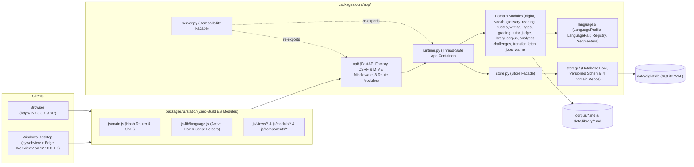

# Diglota Architecture

Diglota is a local-first, reading-focused language learning application built around a single Python/FastAPI engine, a zero-build ES-module web UI, and an optional Windows `pywebview` desktop shell.

This document describes the repository layout, module boundaries, data model, security/concurrency guarantees, and design invariants. For endpoint details see [`API.md`](API.md); for adding new language pairs see [`LANGUAGE_PAIRS.md`](LANGUAGE_PAIRS.md); for testing and Windows builds see [`DEVELOPMENT.md`](DEVELOPMENT.md).

---

## 1. System Overview



---

## 2. Repository Layout

```text
.
├── packages/
│   ├── core/
│   │   ├── app/
│   │   │   ├── languages/            # Pluggable language-pair layer
│   │   │   │   ├── types.py          # LanguageProfile, LanguagePair, SameScriptHMMSegmenter, CrossScriptSegmenter
│   │   │   │   ├── en_es.py          # English -> Spanish profile (default)
│   │   │   │   ├── en_fr.py          # English -> French profile
│   │   │   │   └── registry.py       # Thread-safe LanguageRegistry
│   │   │   ├── storage/              # Modular SQLite persistence
│   │   │   │   ├── db.py             # Thread-tracked pool, BEGIN IMMEDIATE transactions, backup/reset
│   │   │   │   ├── schema.py         # 15-table DDL + PRAGMA user_version migrations
│   │   │   │   ├── vocabulary.py     # Words, SM-2 cards, reviews, Anki export
│   │   │   │   ├── reading.py        # Progress, lookups, exposure analytics, scaffolding, activity
│   │   │   │   ├── content.py        # Kept quotes + writing pieces & batch-loaded revisions
│   │   │   │   └── ops.py            # AI cache, background jobs, quiz attempts, weekly challenges
│   │   │   ├── api/                  # FastAPI HTTP/SSE layer
│   │   │   │   ├── __init__.py       # create_app(), lifespan, CSRF guard, JS MIME static handler
│   │   │   │   ├── deps.py           # get_app(), require_tutor(), require_article()
│   │   │   │   ├── schemas.py        # All Pydantic request models
│   │   │   │   └── routes/           # system, library, vocabulary, quotes, exercises, imports, writing, jobs
│   │   │   ├── runtime.py            # Thread-safe App container (hot model reload, glossary/graph caches, job launchers)
│   │   │   ├── server.py             # Compatibility facade exporting app, App, ctx, schemas & route callables
│   │   │   ├── store.py              # Compatibility facade composing storage/ repositories
│   │   │   ├── config.py             # Settings precedence (.env / DIGLOT_ENV_FILE vs data/settings.json)
│   │   │   ├── diglot.py             # Diglot Markdown parser & span segmenter
│   │   │   ├── vocab.py              # Stemming & text vocabulary coverage
│   │   │   ├── glossary.py           # Offline morphological glossary mined from corpus + deck
│   │   │   ├── reading.py            # Scroll-position to token-exposure mapping (thread-safe cache)
│   │   │   ├── library.py            # Unified read-only corpus + writable imported library catalogue
│   │   │   ├── corpus.py             # IDF-weighted passage similarity graph & topic clustering
│   │   │   ├── analytics.py          # Reading exposure & scaffolding analytics
│   │   │   ├── quotes.py             # Span-accurate sentence capture & clipping
│   │   │   ├── writing.py            # Free-writing metrics, prompts, improvement modes & annotations
│   │   │   ├── challenges.py         # Weekly reading/review/writing goal evaluation
│   │   │   ├── levels.py             # CEFR levels, target-share presets (15%–75%) & weave grains
│   │   │   ├── registers.py          # Register taxonomy & heuristic classification
│   │   │   ├── transfer.py           # diglot/1 portable Markdown export, digest verification & import
│   │   │   ├── fetch.py              # SSRF-guarded HTTP fetcher, readability extractor & web discovery
│   │   │   ├── ingest.py             # URL/paste/writing -> woven Markdown lesson pipeline
│   │   │   ├── llm.py                # OpenAI-compatible HTTP client with reasoning-budget escalation
│   │   │   ├── tutor.py              # Chat LLM prompts & PROMPT_VERSION cache keys
│   │   │   ├── judge.py              # TypeSafe Jev calibrated judgment client
│   │   │   ├── grading.py            # 3-tier grading ladder (Jev -> Tutor -> local overlap)
│   │   │   ├── recommend.py          # Gloss-probe vocabulary recycling & register-gap detection
│   │   │   ├── srs.py                # Pure SM-2 spaced repetition scheduler
│   │   │   ├── jobs.py               # Bounded thread-pool job manager with SQLite history & SSE stream
│   │   │   └── warm.py               # Speculative background glossary warming
│   │   └── tests/                    # Core pytest unit & calibration tests
│   ├── ui/static/                    # Zero-build frontend (index.html, style.css, js/, brand/, fonts/)
│   ├── web/run.py                    # CLI & Uvicorn server entrypoint
│   └── win/                          # Windows desktop shell (diglota_win/), PyInstaller specs, installer/uninstaller & tests
├── corpus/                           # Curated Markdown lessons (ships 1 sample lesson)
├── assets/                           # Brand SVG sources & README screenshots
├── tools/                            # QA & maintainer tools (segment_qa, segment_preview, ui_test, publish)
├── docs/                             # ARCHITECTURE.md, LANGUAGE_PAIRS.md, API.md, DEVELOPMENT.md
├── run.py                            # Root launcher delegating to packages/web/run.py
└── Open Diglota.vbs                  # Windows windowless browser launcher
```

---

## 3. Core Architectural Invariants

1. **Two Roots (`PROJECT_ROOT` vs `BUNDLE_ROOT`).**
   - Configured in [`packages/core/app/config.py`](../packages/core/app/config.py).
   - `PROJECT_ROOT` holds writable user state (`data/`, `corpus/`, `.env`). In a PyInstaller build (`sys.frozen`), it resolves to the directory containing `Diglota.exe`.
   - `BUNDLE_ROOT` holds read-only shipped assets (`packages/ui/static/`). When frozen, it resolves to `sys._MEIPASS`.
2. **One Engine Across All Surfaces.**
   - Web (`run.py`), Windows VBS (`Open Diglota.vbs`), and Windows Desktop (`packages/win/diglota_win/shell.py`) all run the exact same FastAPI `app` from `app.server`. The desktop shell binds `127.0.0.1:0` (ephemeral port) in-process so it never collides with a web instance on `8787`.
3. **Settings Precedence & Secret Containment.**
   - `data/settings.json` (written atomically by the Settings panel) overlays `.env` / `DIGLOT_ENV_FILE`. Setting a panel value to `""` deletes the override and falls back to the environment.
   - `Settings.llm_api_key` and `Settings.typesafe_api_key` carry `repr=False`. `GET /api/settings` returns `key_set` plus `key_hint` (`abc…wxyz`, or `"set"` for keys `<= 8` chars) for LLM, and `key_set` only for Jev — never raw key material.
4. **Tutor vs. Judge Split & 3-Tier Grading.**
   - **Tutor (`tutor.py`)** generates text/JSON (glosses, explanations, quizzes, drills, writing feedback, weaves).
   - **Judge (`judge.py`)** evaluates calibrated semantic probabilities via TypeSafe Jev.
   - **Grading (`grading.py`)** falls back `jev → tutor → local`. The `local` tier is deliberately asymmetric:
     - `translate`: `may_fail=False` (a valid paraphrase sharing few words is marked *unverified*, never *wrong*).
     - `cloze` and `comprehension`: `may_fail=True` (a single blank or factual question has a concrete reference).
     - `writing`: 2 tiers only (`jev → tutor`); returns an explicit unavailable verdict offline rather than fabricating a score.
5. **Prompt-Versioned Caching.**
   - Cached by `tutor.cache_key(feature, ...)` (`PROMPT_VERSION`): `gloss`, `explain`, `translate`, `quiz`, `drills`, `writing` feedback, and `weave` chunks.
   - Deliberately uncached: `improve_writing`, `suggest_next`, `translation_feedback`, and grading verdicts.
   - Transient failures during `deep=True` word lookups never overwrite an existing valid cached gloss.
6. **Zero-Build Native ES Modules on Frontend.**
   - `packages/ui/static/index.html` loads `<script type="module" src="/static/js/main.js"></script>`.
   - `packages/core/app/api/__init__.py` explicitly registers `mimetypes.add_type("text/javascript", ".js")` and forces `Content-Type: text/javascript; charset=utf-8` + `Cache-Control: no-cache` on static `.js` responses so Windows HKCR registry overrides cannot break ES module execution in Edge WebView2 or Chrome.
   - `packages/ui/static/js/lib/language.js` centralizes active language-pair metadata, script-aware tokenization, TTS voice selection, and Unicode-safe cloze/highlight logic while keeping existing DOM IDs, CSS classes, themes, and `localStorage` (`diglot.*`) keys intact.
7. **Storage Compatibility Identifiers.**
   - Environment variables (`DIGLOT_*`), database filename (`data/diglot.db`), CSV export filename (`diglot-vocabulary.csv`), `localStorage` prefix (`diglot.*`), and lesson sharing format (`diglot/1`) retain the `diglot` prefix intentionally to preserve upgrade compatibility for existing users.

---

## 4. Persistence Model (`data/diglot.db`)

Managed by [`packages/core/app/storage/`](../packages/core/app/storage/) with SQLite WAL mode, `PRAGMA foreign_keys = ON`, `PRAGMA user_version = 2`, thread-tracked connections (all closed cleanly on `Store.close()`), and explicit `BEGIN IMMEDIATE` write transactions to avoid WAL lock-upgrade deadlocks.

| Table | Primary Key / Unique | Purpose |
|---|---|---|
| `words` | `id PK`, `UNIQUE(lemma)` | Saved vocabulary terms, lemma, gloss, POS, note, source article, context, `language_pair`. |
| `cards` | `id PK`, `UNIQUE(word_id, kind)` | SM-2 schedule per saved word (`ease`, `interval_days`, `reps`, `lapses`, `due_at`). |
| `reviews` | `id PK` | Append-only review log (`card_id`, `rating`, `reviewed_at`, `elapsed_ms`). |
| `article_progress` | `slug PK` | Scroll `position`, `completed_at`, `seconds_spent`, monotonic `credited_to`, `language_pair`. |
| `events` | `id PK` | Daily activity ledger (`review`, `read`, `quiz`, `quote`, `writing`, `challenge`). |
| `quiz_attempts` | `id PK` | Recorded translation/cloze exercise attempts and outcomes. |
| `cache` | `key PK` | Prompt-versioned JSON cache for Tutor and weave chunks. |
| `lookups` | `id PK` | Every dictionary lookup (drives `2+` lookup recommendations). |
| `jobs` | `id PK` | Persistent background job history (`queued`, `running`, `done`, `failed`, `cancelled`). |
| `exposure` | `PK(day, slug, lemma)` | Aggregated target-language words scrolled past (`times`, `known`, `glossed`, `first_day`, `language_pair`). |
| `scaffolding` | `id PK` | Reading-aid dependence events (`gloss-on`, `gloss-off`, `spanish-only`, `target-only`, `focus`, `full-entry`, `explain`, `translate`). |
| `quotes` | `id PK`, `UNIQUE(text)` | Kept sentences (`text`, `es`, `en`, `glosses`, `note`, `article_slug`, span offsets, `language_pair`). |
| `challenges` | `id PK` | Active and historical weekly goals (`kind`, `target`, `started_at`, `ended_at`, `completed_at`, `language_pair`). |
| `writings` | `id PK` | Writing practice pieces (`title`, `prompt`, `created_at`, `updated_at`, `language_pair`). |
| `revisions` | `id PK` | Per-version text, measurements, verdicts, and inline feedback belonging to a writing piece. |

---

## 5. Security & Concurrency Boundaries

- **Same-Origin CSRF Protection:** `same_origin_csrf_guard` middleware rejects cross-origin `POST`/`PUT`/`PATCH`/`DELETE` requests whose `Origin` or `Referer` is not loopback (`127.0.0.1`, `localhost`, `::1`).
- **SSRF & Payload Caps (`fetch.py`):** Blocks non-`http(s)` schemes and loopback/private/link-local/multicast/reserved IP targets on both initial requests and HTTP redirects; enforces a 5 MiB wire cap and 20 MiB decompression cap.
- **XSS & CSV Formula Defense:** Frontend validates `http(s):` via `safeHttpUrl()` before rendering imported/shared article links; `/api/export.csv` neutralizes leading `=`, `+`, `-`, `@`, `\t`, `\r` cells.
- **Thread Safety & Clean Shutdown:**
  - `App` synchronizes model hot-reloads (`_model_lock`, closing replaced `Judge` and `GlossWarmer`), glossary rebuilds (`_glossary_lock`), and corpus graph rebuilds (`_graph_lock`).
  - `Library`, `reading._CACHE`, `GlossWarmer`, and `JobManager` guard all shared mutable state with locks.
  - `JobManager.stop()` wakes all SSE subscriber queues with a `None` sentinel so open `/api/jobs/stream` connections terminate immediately on shutdown.
